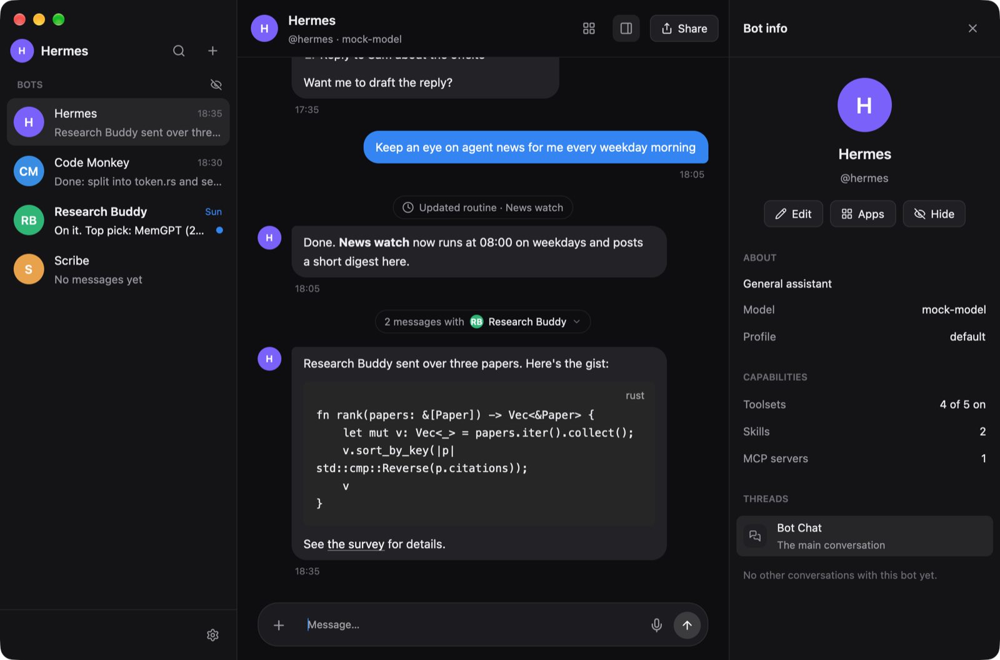
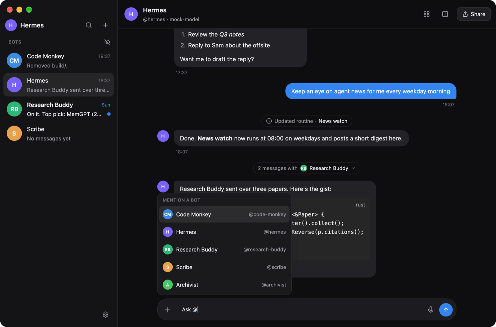
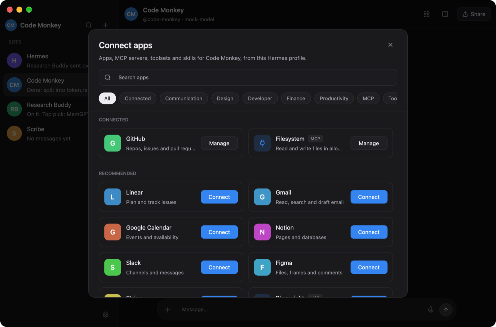
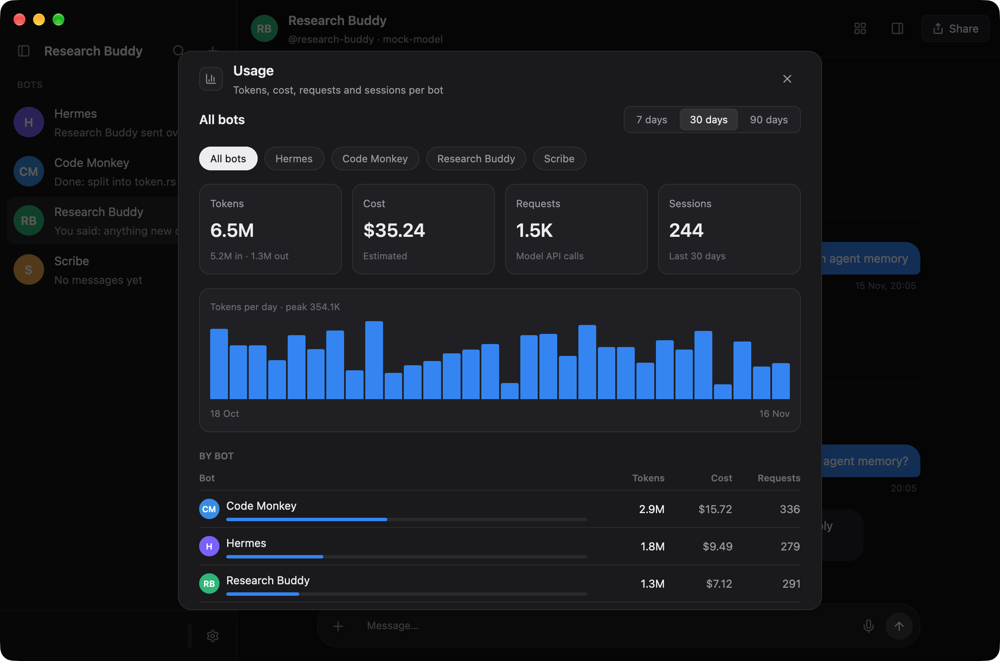
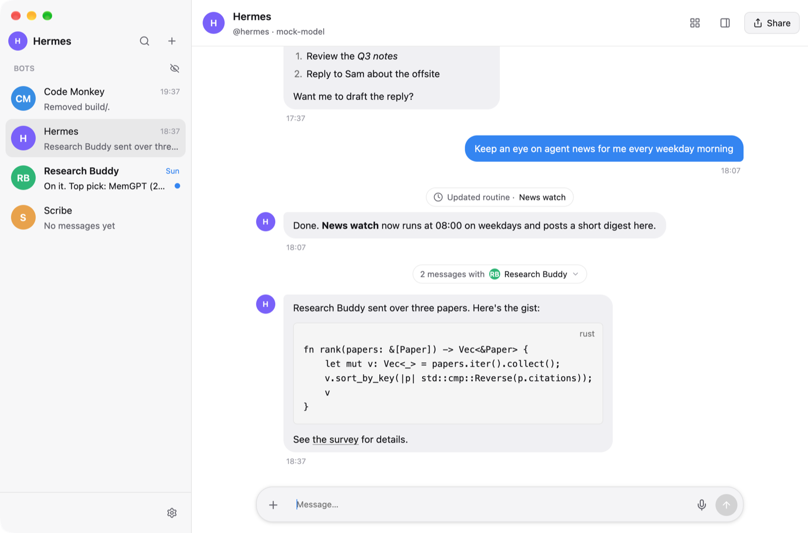

# Hermes Desktop

A fast, lightweight, native desktop client for [Hermes Agent](https://hermes-agent.nousresearch.com),
written in Rust on [GPUI](https://www.gpui.rs) — no Electron, no webview. It runs on macOS,
Windows and Linux (X11 and Wayland).



> Hermes Desktop is an independent community client. It is not made by or affiliated with Nous
> Research. It talks only to your own Hermes, using Hermes' official APIs.

## Install

**macOS and Linux**

```sh
curl -fsSL https://raw.githubusercontent.com/j4ckxyz/hermes-desktop/main/install.sh | bash
```

**Windows** (PowerShell)

```powershell
irm https://raw.githubusercontent.com/j4ckxyz/hermes-desktop/main/install.ps1 | iex
```

Both download the latest [release](https://github.com/j4ckxyz/hermes-desktop/releases/latest),
check it against the release's `SHA256SUMS` (and refuse to install on a mismatch), and never
need administrator rights:

| | Installs to | Also |
|---|---|---|
| macOS (Apple silicon and Intel, one universal app) | `/Applications/Hermes.app` (`~/Applications` if not writable) | clears the download quarantine flag |
| Linux x86_64 and arm64 | `~/.local/bin/hermes-desktop` | menu entry and icon in `~/.local/share` |
| Windows x86_64 | `%LOCALAPPDATA%\Programs\Hermes Desktop` | Start Menu shortcut |

Set `HERMES_VERSION=v0.6.0` to install a specific release. Run the same command again to update.
Prefer to look first? Read [install.sh](install.sh) / [install.ps1](install.ps1), or download an
archive from the [Releases](https://github.com/j4ckxyz/hermes-desktop/releases) page and compare
it with `SHA256SUMS` yourself.

**macOS signing.** Releases are *ad-hoc* signed: there is no paid Apple Developer ID, so they are
not notarised. The install script clears the quarantine flag for you. If you download the `.dmg`
or `.zip` in a browser instead, macOS will say it can't verify the developer: right-click
Hermes → **Open** once, or run `xattr -dr com.apple.quarantine /Applications/Hermes.app`.

**Linux libraries.** The app needs a few common libraries at runtime; on Debian/Ubuntu:
`sudo apt install libxkbcommon-x11-0 libvulkan1 libwayland-client0 libfontconfig1 libdbus-1-3`.

**Uninstall.** macOS: delete `Hermes.app`. Linux: delete `~/.local/bin/hermes-desktop`,
`~/.local/share/applications/hermes-desktop.desktop` and the icon. Windows: delete the install
folder and the Start Menu shortcut. Settings and caches live in the usual per-user config and
data folders; saved credentials are in the OS keychain under "dev.hermes-desktop".

## Features

- **Every Hermes profile is a bot**, using the same Bot Mode model as the official desktop app.
  Each bot has one continuous chat: its Hermes sessions (CLI, Telegram, Bot Chat…) are merged
  into a single stream with date dividers, and after a long break Hermes compacts the context
  (or starts a fresh session) behind the scenes to save tokens.
- **Several servers side by side**: this computer, a homelab or a VPS over Tailscale. Sign in
  with your Hermes dashboard username and password; credentials stay in the OS keychain.
- **Live streaming** of replies, tool calls and sub-agents, with collapsible event chips,
  approvals (scoped to the chat you're looking at), and replies that survive a dropped
  connection.
- **@mention other bots** and see bot-to-bot messages as distinct cards.
- **Slash commands** with arguments and descriptions, from your Hermes' live command catalog.
- **Apps & Connectors**, built on Hermes' official connector, MCP, toolset and skill catalogs.
- **Usage**: tokens, cost, requests and sessions per bot.
- A ⌘K command palette, pinning, unread markers, native notifications, light and dark themes
  with accent colours, keyboard navigation and screen-reader labels.

| | |
|---|---|
|  |  |
|  |  |

### Shortcuts

| Shortcut (Ctrl on Windows/Linux) | Action |
|---|---|
| ⌘K | Command palette and search |
| ⌘N | New bot |
| ⌘1–9 | Jump to bot (hold ⌘ to see the numbers; pinned bots come first) |
| ⇧⌘] / ⇧⌘[ (or ⌃Tab / ⌃⇧Tab) | Next / previous bot |
| ⇧⌘P | Pin or unpin the bot |
| ⌘B | Show or hide the sidebar (remembered) |
| ⌘L | Focus the message box |
| ⌘I | Bot info & threads |
| ⇧⌘A | Apps & Connectors |
| ⇧⌘U | Usage |
| ⌘, | Settings |
| ⌘U / ⇧⌘C / ⇧⌘. | Attach files / copy conversation / stop reply |
| / and @ | Slash commands / mention a bot |
| Esc | Close the top overlay |

## Connect

Run `hermes dashboard` (or `hermes serve`) on the machine that hosts your agent. On first launch
Hermes Desktop finds a dashboard on this computer, or you type a remote or Tailscale address. Then
sign in with the same username and password as the web dashboard; a dashboard on this computer
without accounts needs no sign-in. Sessions renew on their own. Add more servers, sign out or
switch servers under **Settings → Account**. A dashboard session token still works under
*Advanced*. Credentials are kept only in the OS keychain (macOS Keychain, Windows Credential
Manager, or Secret Service on Linux). The client only speaks Hermes' official protocols: the gateway WebSocket
`/api/ws` and the dashboard REST API. See [docs/PROTOCOL.md](docs/PROTOCOL.md).

## Build from source

Needs a recent stable Rust (1.85+).

```sh
cargo build --release -p hermes-desktop
./target/release/hermes-desktop
```

Linux also needs the X11/Wayland, Vulkan, fontconfig and D-Bus development packages:
`sudo ./scripts/linux-deps.sh` installs them on Debian/Ubuntu.

### Try it without Hermes

The repo includes `hermes-mock`, a stand-in server that follows Hermes' documented wire format.
The `HERMES_DESKTOP_*` variables only work in debug builds:

```sh
cargo run -p hermes-mock -- --port 9119 --token dev-token &
HERMES_DESKTOP_URL=http://127.0.0.1:9119 HERMES_DESKTOP_TOKEN=dev-token cargo run -p hermes-desktop
```

To try the sign-in flow, run a gated mock and start the app without `HERMES_DESKTOP_URL`:
`cargo run -p hermes-mock -- --port 9120 --basic-auth demo:demo-password`.

## Releases

Pushing a `v*` tag runs the [Release workflow](.github/workflows/release.yml) on GitHub's free
hosted runners. It builds the universal macOS app (`.dmg` and `.zip`), Linux x86_64 and arm64
tarballs and a Windows x86_64 zip, publishes them with `SHA256SUMS`, and then runs both install
scripts on fresh macOS, Linux and Windows runners against the published release.

## Contributing

See [AGENTS.md](AGENTS.md) for the layout, rules and checks, [PLAN.md](PLAN.md) for the design,
and [docs/PROTOCOL.md](docs/PROTOCOL.md) for the Hermes APIs used. Changes are listed in
[CHANGELOG.md](CHANGELOG.md).

## Licence

[MIT](LICENSE)
